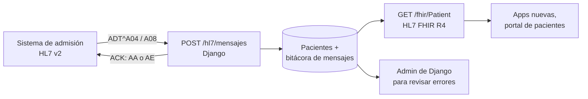

# 🔄 Puente HL7 v2 → FHIR con Django

[](https://github.com/ttom0001/hl7-fhir-django/actions/workflows/ci.yml)


Un servicio chico que hace algo muy común en un hospital: **recibe mensajes HL7 v2** del sistema de admisión (cuando se registra o se actualiza un paciente), **responde con un ACK**, guarda los datos y los **expone en HL7 FHIR R4** para que los sistemas nuevos los consuman.

> Todos los datos son ficticios. Es un proyecto de aprendizaje.

## Por qué lo hice

Cuando empecé a estudiar interoperabilidad en salud me di cuenta de algo: FHIR es el estándar nuevo, pero en la mayoría de las clínicas los sistemas todavía se hablan con **HL7 v2**, esos mensajes de texto con barras `|` y circunflejos `^` que existen desde los 90. El trabajo real está en el medio: hacer que lo viejo y lo nuevo convivan.

Ya había armado una [agenda de turnos con FHIR en Java + Spring Boot](https://github.com/ttom0001/agenda-salud-fhir). Este proyecto es la otra mitad: **leer HL7 v2 en Python con Django** y traducirlo a FHIR. Igual que en el otro, el parser lo escribí a mano, sin librerías, para entender cada campo.

## Qué hace



- **Recibe ADT^A01, A04 y A08** (internación, registro y actualización de paciente) por HTTP.
- **Lee el segmento PID**: DNI (PID-3), apellido y nombre (PID-5), nacimiento (PID-7), sexo (PID-8) y teléfono (PID-13).
- **Responde un ACK** como espera cualquier sistema HL7: `AA` si salió bien, `AE` con el motivo si algo falló.
- **No duplica pacientes**: un A08 del mismo DNI actualiza en vez de crear otro.
- **Guarda cada mensaje en una bitácora**, incluso los que fallan, para poder revisarlos desde el admin de Django.
- **Expone FHIR R4**: `GET /fhir/Patient/<id>` y búsqueda `GET /fhir/Patient?identifier=<dni>` que devuelve un `Bundle`.

## Un ejemplo

Esto es lo que manda el sistema de admisión (un segmento por línea):

```
MSH|^~\&|HIS|CLINICA|AGENDA|CLINICA|20301115083000||ADT^A04|MSG0001|P|2.5
EVN|A04|20301115083000
PID|1||30111222^^^RENAPER^DNI||Pérez^Ana||19850412|F|||Av. Maipú 100^^Ushuaia||2901000001
```

Lo que responde el servicio:

```
MSH|^~\&|AGENDA|CLINICA|HIS|CLINICA|20301115083001||ACK^A04|ACK20301115083001|P|2.5
MSA|AA|MSG0001
```

Y el mismo paciente en FHIR (`GET /fhir/Patient?identifier=30111222`):

```json
{
  "resourceType": "Bundle",
  "type": "searchset",
  "total": 1,
  "entry": [{
    "fullUrl": "Patient/1",
    "resource": {
      "resourceType": "Patient",
      "id": "1",
      "identifier": [{ "use": "official", "system": "http://www.renaper.gob.ar/dni", "value": "30111222" }],
      "name": [{ "use": "official", "family": "Pérez", "given": ["Ana"] }],
      "gender": "female",
      "birthDate": "1985-04-12"
    }
  }]
}
```

## Probarlo

```bash
pip install -r requirements.txt
python manage.py migrate
python manage.py runserver
```

En otra terminal, este script en Bash simula el sistema de admisión, muestra el ACK y pide el paciente en FHIR:

```bash
./scripts/enviar_hl7.sh
```

Para ver la bitácora de mensajes: `python manage.py createsuperuser` y entrá a http://127.0.0.1:8000/admin.

## Pruebas

```bash
python manage.py test
```

Son 13 pruebas: lectura del MSH y del PID, distintos saltos de línea, ACK con el ID de control original, alta y actualización sin duplicados, mensajes rotos que responden `AE` y quedan registrados, tipos no soportados y la forma de los recursos FHIR. En cada `push`, GitHub Actions corre las pruebas, verifica que las migraciones coincidan con los modelos, levanta el servidor y manda un mensaje real con el script.

## Lo que aprendí

- En el segmento **MSH los campos están corridos uno**: MSH-1 es el propio separador `|`, así que MSH-9 (tipo de mensaje) cae en la posición 8 al separar el texto. Es el error más clásico al leer HL7 a mano.
- HL7 v2 separa segmentos con **retorno de carro** (`\r`), no con salto de línea. En la práctica llegan las dos cosas, así que el parser acepta ambas.
- El **ACK es parte del contrato**: si no respondés, el sistema que envía reintenta o se traba. Por eso hasta un mensaje roto recibe un `AE` con el motivo.

## Lo que haría después

- Recibir los mensajes por **MLLP sobre TCP**, que es como viajan en muchos hospitales, además de HTTP.
- Soportar más eventos (A03 alta, A40 fusión de pacientes) y el escapado de caracteres de HL7 (`\F\`, `\S\`).
- Validar los recursos FHIR contra los perfiles de la guía de Argentina.

## Sobre cómo lo construí

Me apoyé en herramientas de IA generativa para avanzar más rápido, como hago en mi día a día; las decisiones, las reglas y las pruebas las definí y revisé yo. Te explico cualquier parte con gusto.

---

Hecho por **Tomás Frem** · Tolhuin, Tierra del Fuego · [LinkedIn](https://www.linkedin.com/in/tomas-frem) · [Más proyectos](https://github.com/ttom0001)
